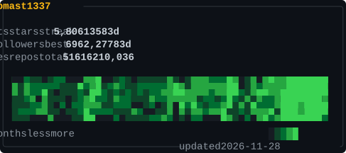

### Nicolas Vyčas Nery

Software engineer · Rio de Janeiro

[LinkedIn](https://www.linkedin.com/in/nicolas-vycas/) · [X](https://twitter.com/NicolasVycas)

<table border="none" width="100%">
  <tr>
    <td width="50%" valign="top" align="center">
      
        
      
        
      
    </td>
    <td width="50%" valign="top" align="center">
      
        
      
    </td>
  </tr>
</table>

  

